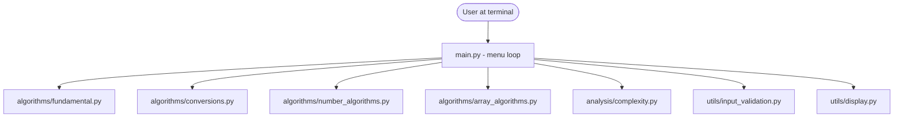

# PROJECT_REPORT_CONTENT.md

## 1. Cover Page

- Project Title: AlgorithmLab - Fundamental Algorithm & Array Toolkit
- Course: CSE1021 - Problem Solving / Python
- Student Name: Neeraja Tosh
- Registration Number: 26BCE10574
- Submission Date: 29th September 2026
- Faculty Guide Name: Dr. Venkat Prasad Padhy

## 2. Introduction

AlgorithmLab is a command-line Python toolkit built to demonstrate
the fundamental algorithms and array/list techniques covered in the
CSE1021 syllabus. It lets a user select an algorithm category from a
terminal menu, provide input, and view both the computed result and
a short explanation of the algorithm's approach and complexity. The
project deliberately avoids GUIs, web frameworks, databases and any
external dependencies, focusing purely on the core Python and
algorithmic concepts taught in the course.

## 3. Problem Statement

(See `statement.md` for the canonical version - summarized here.)

First-year students learn many small algorithms individually across
different units, but rarely have one place to run, compare, and
reflect on their efficiency together. AlgorithmLab addresses this by
implementing these algorithms from scratch in one interactive,
menu-driven command-line application.

## 4. Objectives

- Implement CSE1021's fundamental algorithms and array techniques by
  hand, using iteration, in plain Python.
- Build a simple, crash-resistant, menu-driven command-line
  interface.
- Provide a basic algorithm-analysis reference (approach, time
  complexity, space complexity) for every algorithm implemented.
- Demonstrate Python's core data structures (lists, tuples, sets,
  dictionaries), including a simple time-tradeoff example.
- Keep the code readable and explainable by a first-year student.

## 5. Functional Requirements

- FR1: Display a main menu with 6 options.
- FR2: Allow selecting and running any algorithm in Modules 1-3 with
  user-supplied input.
- FR3: Show a short explanation (approach + complexity) after every
  algorithm run.
- FR4: Allow browsing algorithm analysis directly (Module 4) without
  running the algorithm.
- FR5: Validate all input and re-prompt on invalid input rather than
  crashing.
- FR6: Provide sample inputs/outputs via an Examples module.

## 6. Non-Functional Requirements

- **Usability** - consistent, numbered menus with a "Back" option
  everywhere.
- **Reliability** - handles empty input, non-numeric input,
  out-of-range values, and unexpected EOF/interrupt signals without
  crashing.
- **Maintainability** - each algorithm category is isolated in its
  own module; adding an algorithm means adding one function plus one
  dictionary entry.
- **Performance** - algorithms use complexity-appropriate approaches
  for a first course (e.g. Sieve of Eratosthenes, binary
  exponentiation).
- **Resource efficiency** - no external dependencies, no persistent
  storage, small bounded in-memory data structures only.

## 7. System Architecture

(See `docs/architecture.md` for the full diagrams - summarized here.)

AlgorithmLab is a single-process command-line application with three
layers: a presentation layer (`main.py` + `utils/`), an algorithm
layer (`algorithms/`), and an analysis layer (`analysis/`). There is
no database, no network access, and no persistent state.



## 8. Design Diagrams

All diagrams (component diagram, workflow flowchart, use case
diagram, and sequence diagrams) are in `docs/architecture.md` and
`docs/workflow.md`, written as Mermaid code so they render directly
on GitHub. Copy the ones you want into this section, or take
screenshots of the rendered versions from GitHub if your report
format requires images rather than code blocks.

## 9. Design Decisions & Rationale

(See `docs/architecture.md` section 7 for the full table -
summarized here.)

- Plain functions instead of classes, matching the course's
  function-based approach.
- Iterative implementations throughout, since the syllabus favors
  iteration over recursion at this stage.
- Manually implemented algorithms (GCD, primes, factorial, etc.)
  instead of calling built-in shortcuts, since the goal is to
  demonstrate the algorithm itself.
- A simple sort-based kth-smallest instead of quickselect, trading
  some efficiency for clarity appropriate to a first course (this
  tradeoff is explained to the user directly in the app).

## 10. Implementation Details

- **Language:** Python 3, standard library only.
- **Modules:** `algorithms/fundamental.py`, `algorithms/conversions.py`,
  `algorithms/number_algorithms.py`, `algorithms/array_algorithms.py`,
  `analysis/complexity.py`, `utils/input_validation.py`,
  `utils/display.py`, and `main.py` as the entry point.
- **Key techniques demonstrated:** tuple assignment (swap), linear
  scans, the Euclidean algorithm, the Sieve of Eratosthenes, binary
  exponentiation, two-pointer array reversal, Lomuto partitioning,
  and dictionary-based lookup tables.

## 11. Testing Approach

The project uses Python's built-in `unittest` framework. Each
algorithm module has a corresponding test file in `tests/`, covering:
- **Normal cases** (typical valid input).
- **Boundary cases** (e.g. n = 0, empty arrays, k = 1 or k = length
  of array).
- **Invalid cases** (e.g. negative square root input, k out of
  range, invalid digit for a given base).

Run all tests with:
```bash
python3 -m unittest discover
```

## 12. Learnings & Key Takeaways

Two things really clicked for me while building this. With the Euclidean algorithm, I finally understood why gcd(a, b) = gcd(b, a % b) works — the GCD doesn't change at each step, it just shrinks fast. And building the pseudo-random generator made me realize "random" numbers in code aren't random at all — same seed, same output every time, which I checked myself and which the test suite also confirms.

## 13. Future Enhancements

- Add a quickselect-based kth-smallest as an alternative, faster
  option alongside the current sort-based approach.
- Add an option to export a session's results to a plain text file.
- Add more algorithms if the syllabus scope grows in a later course.
- Add a "compare complexities" view that shows, for a chosen input
  size, how two algorithms' operation counts compare.

## 14. References

Official Python Documentation

Python 3 documentation — built-in functions ord() and chr(): https://docs.python.org/3/library/functions.html
Python 3 documentation — unittest framework: https://docs.python.org/3/library/unittest.html
Python 3 documentation — data structures (lists, tuples, sets, dicts): https://docs.python.org/3/tutorial/datastructures.html
Python 3 documentation — the time module: https://docs.python.org/3/library/time.html

Algorithm References

Sieve of Eratosthenes: GeeksforGeeks, "Sieve of Eratosthenes" — https://www.geeksforgeeks.org/sieve-of-eratosthenes/
Euclidean Algorithm for GCD: GeeksforGeeks, "Euclidean algorithms (Basic and Extended)" — https://www.geeksforgeeks.org/euclidean-algorithms-basic-and-extended/
Lomuto Partition Scheme: GeeksforGeeks, "Lomuto Partition Algorithm" — https://www.geeksforgeeks.org/lomuto-partition-algorithm/
Newton-Raphson Method (for square root): GeeksforGeeks, "Square root of a number using Newton's method" — https://www.geeksforgeeks.org/square-root-of-a-perfect-square/
Binary Exponentiation: GeeksforGeeks, "Modular Exponentiation (Power in Modular Arithmetic)" or cp-algorithms.com, "Binary Exponentiation" — https://cp-algorithms.com/algebra/binary-exp.html
Linear Congruential Generator: Wikipedia, "Linear congruential generator" — https://en.wikipedia.org/wiki/Linear_congruential_generator
