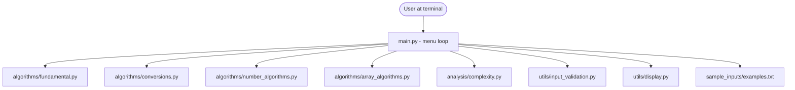
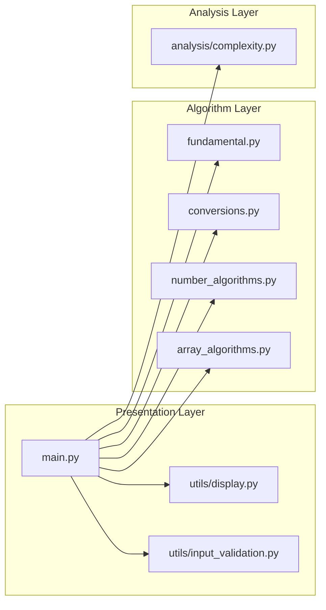

# AlgorithmLab - Architecture Documentation

## 1. Problem Statement

First-year Computer Science students learn many small, individually
simple algorithms (swapping values, computing GCD, reversing an
array, etc.) but rarely see them collected in one place where they
can be run, tested, and compared for efficiency. AlgorithmLab solves
this by providing a single command-line application that lets a
student run each of these algorithms interactively and see both the
result and a short explanation of its time/space complexity.

## 2. Objectives

- Implement the fundamental algorithms from CSE1021 Units 3, 4 and 5
  by hand (not by calling built-in shortcuts that hide the logic).
- Provide a simple, crash-resistant command-line interface.
- Provide a basic algorithm-analysis reference (Unit 1: efficiency
  and analysis of algorithms) for every implemented algorithm.
- Demonstrate the Python data structures from Unit 5 (lists, tuples,
  sets, dictionaries) including a simple time-tradeoff illustration.
- Keep the codebase understandable by a first-year student: plain
  functions, clear names, comments, no frameworks.

## 3. Functional Requirements

- FR1: The system shall display a main menu with 6 options (4
  algorithm/analysis categories, an examples viewer, and exit).
- FR2: The system shall allow the user to select any algorithm from
  Modules 1-3, provide input, and see the computed result.
- FR3: The system shall show a short explanation (approach, time
  complexity, space complexity) after every algorithm run.
- FR4: The system shall let the user browse the analysis for any
  implemented algorithm directly (Module 4), without running it.
- FR5: The system shall validate all user input and re-prompt on
  invalid input instead of crashing.
- FR6: The system shall provide a set of sample inputs/outputs
  (Module 5 - Examples) for reference.

## 4. Non-Functional Requirements

- **Usability**: Menus are numbered and consistent across modules;
  every submenu offers a "Back" option so the user is never stuck.
- **Reliability**: All expected user mistakes (empty input, letters
  instead of numbers, out-of-range k values, division by zero,
  Ctrl+D/Ctrl+C) are handled without the program crashing.
- **Maintainability**: Each algorithm category lives in its own
  module file; adding a new algorithm means adding one function and
  one dictionary entry, not touching unrelated code.
- **Performance**: All implemented algorithms use complexity-aware
  approaches appropriate for a first course (e.g. Sieve of
  Eratosthenes instead of checking every number for primality one by
  one, binary exponentiation instead of repeated multiplication).
- **Resource efficiency**: The application has no external
  dependencies, holds no persistent state, and uses only small,
  bounded in-memory data structures.

Note on realistic scope: this project targets clarity and course
demonstration, not production-grade performance or industrial input
sizes (e.g. the prime sieve is fine for teaching-sized limits, not
for generating primes up to 10^12).

## 5. System Architecture

AlgorithmLab is a single-process, single-threaded command-line
Python application. There is no client-server split, no database,
and no persistent storage - `main.py` is the only entry point, and
it calls into plain function modules.

## 6. Component Diagram

There are only three layers:
1. **Presentation layer** - `main.py` plus the small `utils` helpers,
   responsible for showing menus, reading input, and printing output.
2. **Algorithm layer** - the four `algorithms/` modules, each a
   collection of plain functions with no shared state.
3. **Analysis layer** - `analysis/complexity.py`, a lookup table
   mapping algorithm names to their approach/complexity description.

No object-oriented design was needed here; a first course in Python
problem solving is centered on functions, so the whole project is
written that way deliberately.

## 7. Design Decisions & Algorithm Choices

| Decision | Reasoning |
|---|---|
| Plain functions instead of classes | Matches the course's function-based approach (Unit 2); no shared mutable state needed. |
| Iterative implementations everywhere | The syllabus explicitly favours iteration (while/for) over recursion at this stage. |
| Manual GCD (Euclidean algorithm) instead of `math.gcd` | The purpose is to demonstrate the algorithm, not just call a library function. |
| Sieve of Eratosthenes for prime generation | More efficient (O(n log log n)) than checking each number individually, and is the standard "generate primes" algorithm taught early on. |
| Binary exponentiation for large powers | Demonstrates O(log n) exponentiation instead of O(n) repeated multiplication - a clear efficiency lesson for Unit 4. |
| Sort-based kth-smallest (not quickselect) | Simpler and safer for a first course; the complexity tradeoff (O(n log n) vs O(n) average) is explicitly explained to the user. |
| Dictionary-based complexity lookup | A simple, appropriate data structure (Unit 5: dictionaries) for storing "algorithm name -> explanation" pairs. |
| No classes/OOP, no decorators, no frameworks | Explicitly out of scope for a first Python course; keeps the code readable end-to-end. |

## 8. Complexity Analysis Summary

| Algorithm | Time Complexity | Space Complexity |
|---|---|---|
| Exchange values | O(1) | O(1) |
| Counting | O(n) | O(1) |
| Summation | O(n) | O(1) |
| Factorial (iterative) | O(n) | O(1) |
| Fibonacci sequence | O(n) | O(n) |
| Reverse a number | O(d) digits | O(1) |
| Base conversion (decimal->base) | O(log_base n) | O(log_base n) |
| Base conversion (base->decimal) | O(k) digits | O(1) |
| Square root (Newton) | ~O(log(1/tolerance)) | O(1) |
| Smallest divisor | O(sqrt n) | O(1) |
| GCD (Euclidean) | O(log(min(a,b))) | O(1) |
| Generate primes (sieve) | O(n log log n) | O(n) |
| Prime factorization | O(sqrt n) | O(log n) |
| Pseudo-random (LCG) | O(count) | O(count) |
| Power (binary exponentiation) | O(log exponent) | O(1) |
| nth Fibonacci (iterative) | O(n) | O(1) |
| Reverse array | O(n) | O(1) extra |
| Count elements | O(n) | O(1) |
| Find maximum | O(n) | O(1) |
| Remove duplicates (sorted) | O(n) | O(n) |
| Partition array (Lomuto) | O(n) | O(1) extra |
| kth smallest (sort-based) | O(n log n) | O(n) |

This same information is available live from inside the running
program via Module 4 ("Algorithm Analysis").
