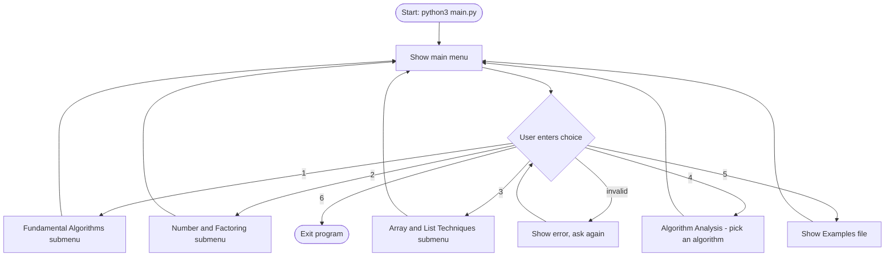
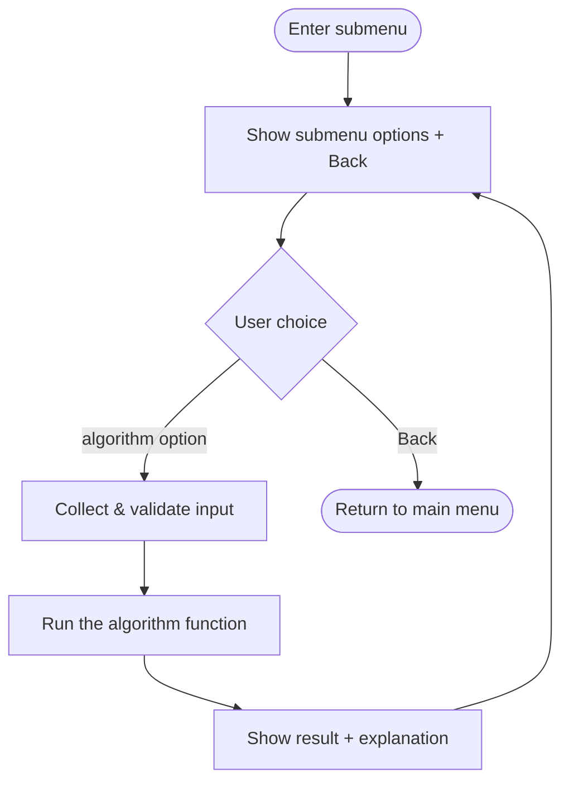
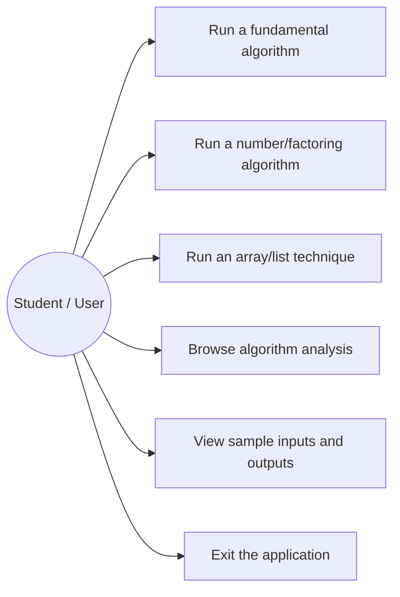
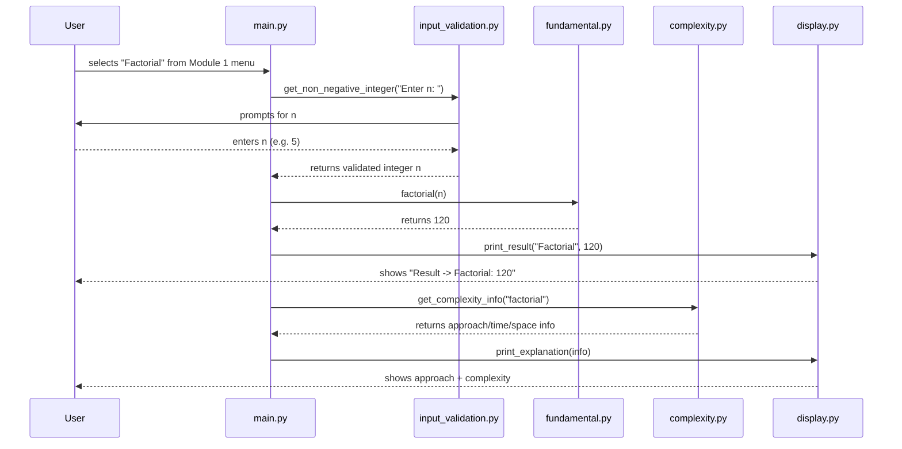
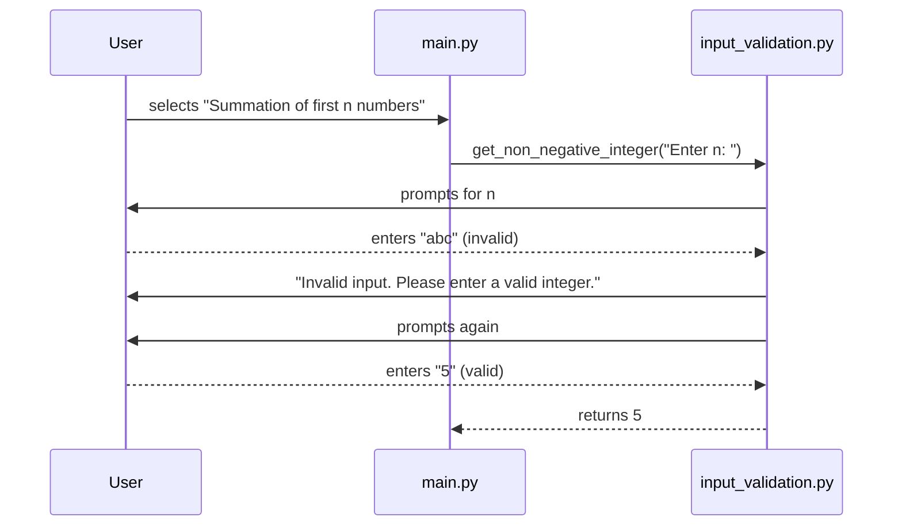

# AlgorithmLab - Workflow & Use Case Documentation

## 1. Workflow Diagram (Flowchart)

This is the overall control flow of the program, from launch to exit.

Each submenu (Fundamental, Number, Array) follows the same internal
pattern:

## 2. Use Case Diagram

There is only one actor (the student/user running the CLI); there
are no external systems, no database, and no network calls, so no
further actors are needed.

## 3. Sequence Diagram - Example: Running "Factorial"

## 4. Sequence Diagram - Example: Invalid Input Handling

## 5. Component/Class Note

This project intentionally has no class diagram: CSE1021 at this
stage covers functions and modules (Unit 2), not object-oriented
design, so AlgorithmLab is written purely with functions grouped
into modules. The closest equivalent is the **component diagram** in
`architecture.md`, which shows how the modules depend on each other.
